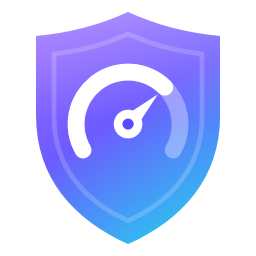
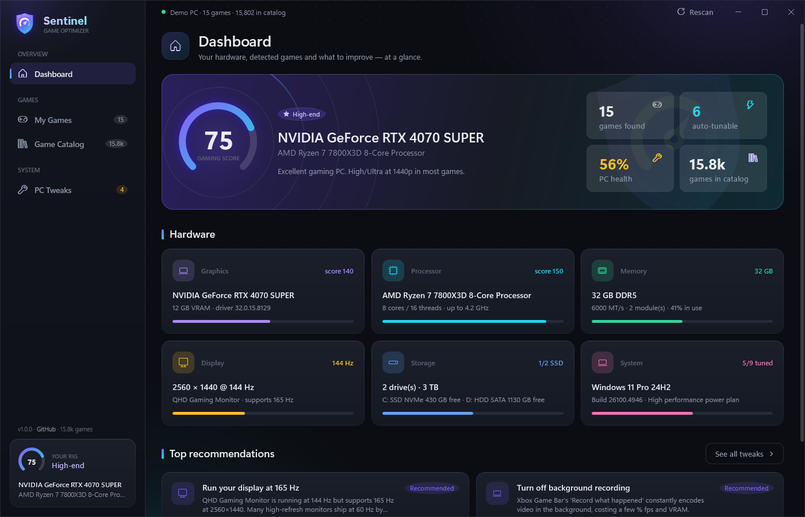
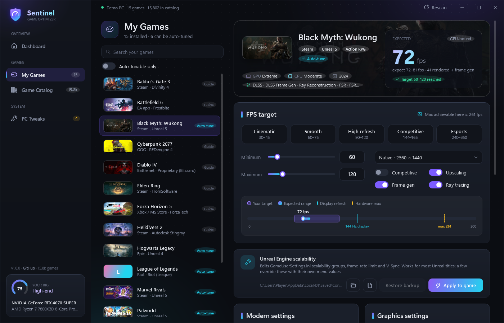
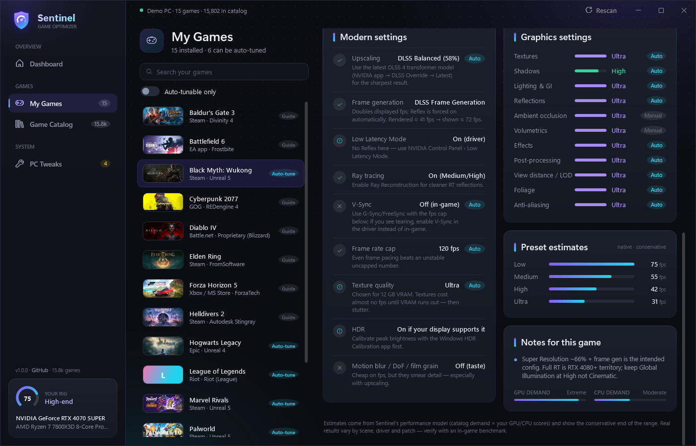
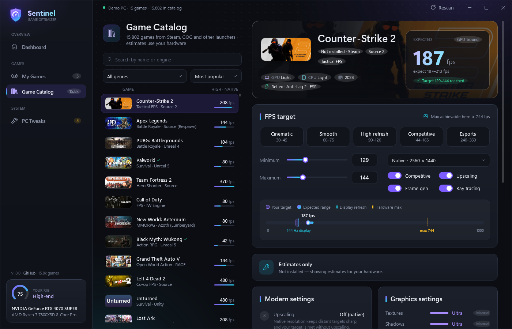
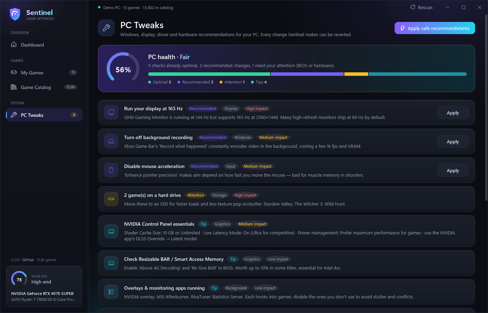

<p align="center"></p>

<h1 align="center">Sentinel — Game Optimizer</h1>

<p align="center">
  Detects your hardware and games, then tunes each game to hit the FPS range you choose,<br>
  including DLSS / FSR / XeSS, frame generation, Reflex, ray tracing and VRR-friendly caps.
</p>

<p align="center">
  <a href="https://github.com/BenScriptsRBX/Sentinel/releases/latest"></a>
  <a href="https://github.com/BenScriptsRBX/Sentinel/actions/workflows/ci.yml"></a>
  <a href="LICENSE"></a>
  
</p>

<p align="center"></p>

---

## Download

Get the latest version from **[Releases](https://github.com/BenScriptsRBX/Sentinel/releases/latest)**:

| File | Use it if |
| --- | --- |
| `Sentinel-<version>-win-x64.zip` | You just want it to work. Self-contained, no .NET install needed. |
| `Sentinel-<version>-win-x64-framework-dependent.zip` | You already have the [.NET 10 Desktop Runtime](https://dotnet.microsoft.com/download/dotnet/10.0). Much smaller. |

Unzip anywhere and run `Sentinel.exe` (Windows 10 or 11, 64-bit). The exe isn't code-signed yet, so Windows SmartScreen may say "Windows protected your PC". Choose **More info**, then **Run anyway**. Checksums are in `SHA256SUMS.txt` on each release.

## What it does

| | |
| --- | --- |
| **Hardware** | CPU, every GPU (with real 64-bit VRAM), memory speed and channels, SSD/HDD/NVMe per drive, every display's current and maximum refresh rate, plus Windows gaming settings. Scored against built-in GPU and CPU performance tables. |
| **Game detection** | Steam (all libraries), Epic, GOG, Ubisoft Connect, EA app, Xbox / Microsoft Store, Battle.net, Riot, Rockstar, Minecraft Java and Roblox. The engine is fingerprinted from the install folder (Unreal, Unity, Source, Godot). |
| **15,802-game catalog** | Demand ratings, modern feature support, frame-rate locks and store availability for each game, sorted by Steam popularity. Browse it to see estimates for games you don't own yet. |
| **FPS-target optimizer** | Pick a range such as 144–165. Sentinel starts at Ultra and repeatedly takes the step with the best FPS gain for the least visual loss. It picks the right upscaler and frame generation for your GPU, keeps textures inside your VRAM and tells you when you're CPU-bound. |
| **Competitive mode** | Keeps native resolution and turns down visual clutter first: shadows, global illumination, reflections, post-processing. No frame generation. |
| **Auto-apply** | Writes settings straight into the game's config file for Unreal Engine 4/5 games, CS2, Apex Legends, GTA V, Red Dead Redemption 2, League of Legends, Minecraft, Roblox and Unity games (beta). It **backs up every file first** and has a one-click restore. Other games get a full in-game guide. |
| **PC Tweaks** | A PC-health score plus fixes you can revert: power plan, Game Mode, background recording, GPU scheduling, windowed-game optimizations, refresh rate, mouse acceleration, per-game dedicated GPU, driver age, XMP/EXPO, memory channels, games on hard drives, free space, overlays and startup apps. |

### Honest numbers

Sentinel would rather under-promise:

- **Conservative figures:** the FPS it shows is the low end of the expected range, about −12%, or −20% for AI-estimated games.
- **Frame-rate locks:** a game's own lock is respected. Elden Ring never shows more than 60.
- **Realistic upscaling:** DLSS, FSR and XeSS gains follow GPU-bound benchmarks, about 1.4× at Quality and 1.75× at Performance, rather than raw pixel counts.
- **Unreachable targets:** if you ask for more than your PC can deliver, it says so and plans for the best your hardware can actually hold. Presets out of reach are greyed out.
- **Tested for every game:** the test suite checks these rules against all 15,802 catalog games on several hardware profiles.

## Screenshots

| | |
| :---: | :---: |
|  |  |
| **My Games:** pick an FPS range and see what your PC can hold | **The plan:** upscaling, frame generation, ray tracing and each graphics setting |
|  |  |
| **Game Catalog:** estimates for 15,802 games, installed or not | **PC Tweaks:** Windows, display and hardware fixes you can revert |

Every screenshot comes from demo mode (`Sentinel.exe --demo`), which shows a made-up PC and game library instead of scanning the PC it runs on.

## Build from source

You need Windows 10/11 and the [.NET 10 SDK](https://dotnet.microsoft.com/download/dotnet/10.0).

```bash
git clone https://github.com/BenScriptsRBX/Sentinel.git
cd Sentinel
dotnet test Sentinel.slnx
dotnet run --project src/Sentinel
```

To build the release zips locally, run `pwsh build/publish.ps1 -Version 1.0.0`. They go to `artifacts/`.

## Catalog data

- **Hand-written entries:** files `01`–`06` in `src/Sentinel/Data/Catalog`, written and checked by hand.
- **Steam's 10,000 most-owned games:** names and app IDs come from [SteamSpy](https://steamspy.com/).
- **GOG-only games:** names, years and cover art addresses come from GOG's public catalog.
- **Other launchers:** Battle.net, Riot, Epic and Xbox exclusives.

For most entries, the engine, demand ratings, feature support and frame-rate locks were **estimated with AI (Claude)**. Those entries are marked `"q": 1` and get the wider safety margin. Corrections are very welcome: use the [catalog correction form](https://github.com/BenScriptsRBX/Sentinel/issues/new?template=catalog_correction.yml) or see [CONTRIBUTING.md](CONTRIBUTING.md).

## Privacy

No account, no telemetry, no ads. Your hardware and game list never leave your PC. The only network requests download game artwork from Steam and GOG. Details are in [PRIVACY.md](PRIVACY.md).

## Contributing

Bug reports, catalog fixes and pull requests are welcome. See [CONTRIBUTING.md](CONTRIBUTING.md) and the [Code of Conduct](CODE_OF_CONDUCT.md). Please report security issues privately as described in [SECURITY.md](SECURITY.md).

## License and legal

- **License:** [MIT](LICENSE). Bundled components are listed in [THIRD-PARTY-NOTICES.md](THIRD-PARTY-NOTICES.md).
- **Terms:** [Terms of Use](TERMS.md) explain what Sentinel changes on your PC and your responsibilities, such as following each game's rules.
- **Disclaimer:** FPS figures are estimates, not benchmarks, and Sentinel is provided as-is with no warranty.
- **No affiliation:** Sentinel is an independent project. It is not affiliated with or endorsed by Valve, Epic Games, GOG, Microsoft, NVIDIA, AMD, Intel, or any game developer or publisher. Game names and artwork belong to their respective owners.
